# E1-1 개발 워크스테이션 구축

> 모든 실습을 직접 수행하고 실제 출력과 캡처로 증거를 남겼습니다. 긴 출력은 `logs/`, 화면 캡처는 `captures/` 폴더에 있습니다.
>
> **보너스 과제 수행:** Docker Compose(단일·멀티 컨테이너, 운영 명령어, 환경 변수)와 GitHub SSH 키 설정 → [보너스 과제](#보너스-과제)

## 미션 개요

터미널과 파일 권한을 다루고 Docker로 웹 서버를 컨테이너화합니다. 포트 매핑, 바인드 마운트 변경 반영, 볼륨 데이터 영속성을 검증하고 수행 결과를 문서화해 GitHub에 제출합니다.

## 실행 환경

| 항목 | 확인값 |
|---|---|
| 작업 폴더 | `C:\Users\ADMIN\E1-1` |
| OS | Windows 11 Home 25H2 (OS 빌드 26200.9711) |
| 쉘 | PowerShell 7.6.9 |
| Docker CLI | Docker version 29.9.2, build a82e528 |
| Docker 데몬 | Docker Server 29.9.2; 컨테이너 5개(실행 3, 중지 2), 이미지 4개 |
| Git | git version 2.56.0.windows.1 |
| GitHub | `https://github.com/smz7093-web/E1-1` |

> 참고: 빌드 26200은 Windows 11입니다. `Get-ComputerInfo`와 레지스트리 `ProductName`은 호환성 때문에 "Windows 10"으로 표시되므로 빌드 번호(`winver`)로 확인했습니다.

```powershell
$PSVersionTable.PSVersion
Get-ItemProperty 'HKLM:\SOFTWARE\Microsoft\Windows NT\CurrentVersion' | Select-Object DisplayVersion, CurrentBuild, UBR
docker --version
docker info
git --version
```

`docker info` 출력에 민감한 정보가 있으면 공유 전에 가립니다.

## 수행 체크리스트

- [x] Linux 터미널에서 위치 이동, 파일/디렉터리 생성 및 목록 확인 (캡처 포함)
- [x] 터미널 파일 내용/빈 파일, 복사·이름 변경·삭제 실습 캡처
- [x] 파일 및 디렉터리 권한 변경 전후 캡처
- [x] `hello-world`, Ubuntu 컨테이너 실행/재진입 실습 캡처
- [x] Docker CLI 버전 확인 (`29.9.2`)
- [x] `docker info` 핵심 출력 요약 기록
- [x] 이미지 목록, 로그·리소스 점검 결과 기록
- [x] 컨테이너 목록 확인 (`docker ps`, 캡처 포함)
- [x] 컨테이너 로그 및 리소스 확인 (`docker logs`, `docker stats`)
- [x] 직접 작성한 Dockerfile 빌드 및 실행
- [x] 포트 매핑 접속 증거(브라우저 주소창/응답)
- [x] 바인드 마운트 호스트 변경 응답 확인
- [x] 컨테이너 삭제 전후 Docker 볼륨 데이터 확인
- [x] GitHub 저장소 생성 및 README 푸시
- [x] `git config --list` 결과와 VS Code GitHub 로그인/저장소 연동 증거
- [x] 트러블슈팅 2건 기록
- [x] (보너스) Docker Compose 단일/멀티 컨테이너, 운영 명령어, 환경 변수, GitHub SSH 키

## 실습 캡처

캡처 원본은 `captures/` 폴더에 있으며, 각 이미지는 아래 해당 섹션 본문에 바로 표시됩니다. 표의 링크를 누르면 원본 크기로 볼 수 있습니다.

| 캡처 | 확인되는 내용 |
|---|---|
| [mydir_list.jpg](captures/mydir_list.jpg) | Ubuntu 컨테이너 `/temp`에서 `touch`, `mkdir`, `ls -l`로 파일과 디렉터리 생성/목록 확인 |
| [chmod.jpg](captures/chmod.jpg) | `file.txt`에 `chmod 600`, `chmod 700`을 적용하고 `ls -l`로 권한 확인. `cdmod` 오타 오류도 기록되어 있음 |
| [cp_rm_mv.jpg](captures/cp_rm_mv.jpg) | `/tmp/e1-practice`에서 빈 파일 생성, 파일 내용 확인, `cp`, `mv` 결과 확인 |
| [cp_rm_mv_chmod.jpg](captures/cp_rm_mv_chmod.jpg) | `rm` 및 삭제 후 목록 확인, 디렉터리에 `chmod 700` 적용 후 `ls -ld`로 확인 |
| [docker_run.jpg](captures/docker_run.jpg) | PowerShell에서 `docker run hello-world` 성공 출력 |
| [exit_exec.jpg](captures/exit_exec.jpg) | 종료된 Ubuntu 컨테이너 시작 후 `docker exec` 재진입, 파일/디렉터리 확인, `exit` 뒤 컨테이너가 실행 중임을 `docker ps`로 확인 |
| [linux_os_release.jpg](captures/linux_os_release.jpg) | 컨테이너 안에서 `/etc/os-release` 확인; 출력은 Ubuntu 26.04.1 LTS |
| [localhost.jpg](captures/localhost.jpg) | 브라우저 `localhost:8080`에서 Docker 웹 페이지 응답 확인 |
| [host_change.jpg](captures/host_change.jpg) | 브라우저 `localhost:8081`에서 호스트 수정 후 문구가 반영된 웹 페이지 확인 |
| [git_config_list.jpg](captures/git_config_list.jpg) | `git config --list` 출력 (이메일 마스킹) |
| [vscode_github.jpg](captures/vscode_github.jpg) | VS Code에서 GitHub 계정 `smz7093-web` 로그인 상태와 `main` 브랜치 연동 확인 |

출력이 긴 증거는 텍스트 로그로 남겼습니다: 볼륨 영속성 [logs/docker_volume.txt](logs/docker_volume.txt), 바인드 마운트 변경 전후 응답 [logs/bind_mount.txt](logs/bind_mount.txt), 웹 서버 로그 [logs/docker_logs_e1-web.txt](logs/docker_logs_e1-web.txt).

## 터미널 조작 기록

터미널 실습은 Ubuntu 컨테이너의 Bash에서 수행했습니다. 수행한 명령의 흐름은 다음과 같습니다(실제 출력은 캡처 참고).

```bash
pwd
mkdir -p /tmp/e1-practice && cd /tmp/e1-practice
touch empty.txt
echo "practice_text" > note.txt
cat note.txt
cp note.txt copy.txt
mv copy.txt renamed.txt
rm renamed.txt
ls -l
```

| 목적 | 명령 및 실제 출력 |
|---|---|
| 위치/목록 | [mydir_list.jpg](captures/mydir_list.jpg), [cp_rm_mv.jpg](captures/cp_rm_mv.jpg) |
| 파일·폴더 조작 | [cp_rm_mv.jpg](captures/cp_rm_mv.jpg), [cp_rm_mv_chmod.jpg](captures/cp_rm_mv_chmod.jpg) |
| 파일 내용/빈 파일 | `cat note.txt` 출력 및 0 byte `empty.txt`가 캡처에 보임 |

**위치 이동, 파일/디렉터리 생성 및 목록 확인** ([mydir_list.jpg](captures/mydir_list.jpg))

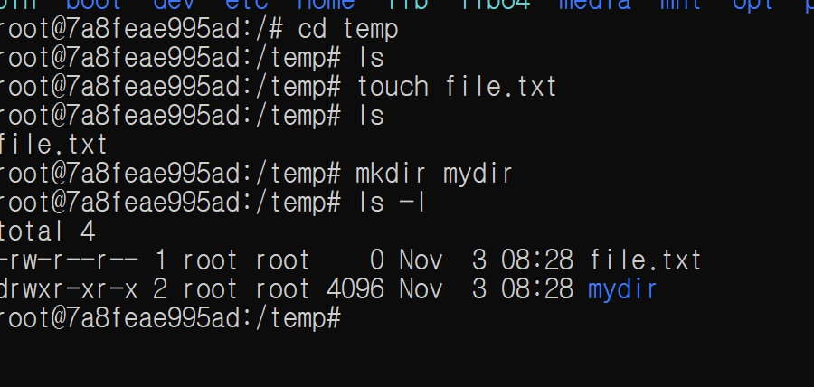

**빈 파일 생성, 내용 확인, 복사·이름 변경** ([cp_rm_mv.jpg](captures/cp_rm_mv.jpg))

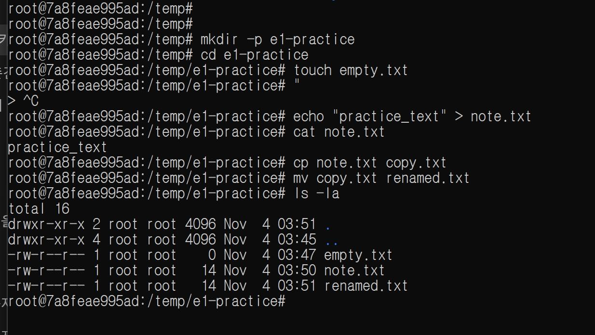

## 권한 실습

권한 실습은 Ubuntu 컨테이너에서 Linux `chmod`로 수행했습니다. (Windows ACL은 별도 모델이라 다루지 않았습니다.)

```bash
ls -l file.txt
chmod 600 file.txt && ls -l file.txt
chmod 700 file.txt && ls -l file.txt
ls -ld .
chmod 700 . && ls -ld .
```

| 대상 | 변경 전 | 수행한 변경 | 변경 후 |
|---|---|---|---|
| 파일 `file.txt` | `-rw-r--r--` | `chmod 600`, 이어 `chmod 700` | 각각 `-rw-------`, `-rwx------` |
| 디렉터리 `e1-practice` | `drwxr-xr-x` | `chmod 700 .` | `drwx------` |

**파일 권한 변경 전후** ([chmod.jpg](captures/chmod.jpg))

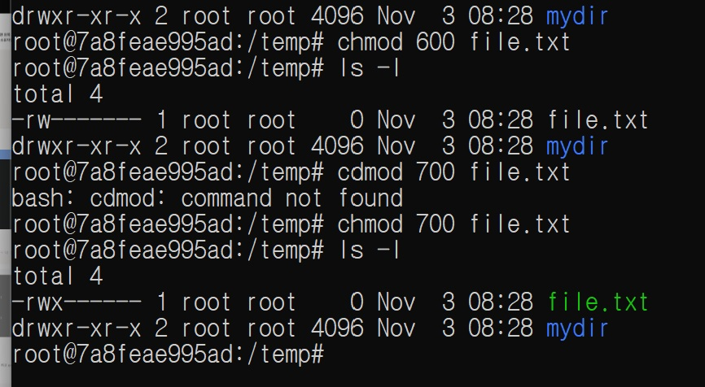

**삭제 및 디렉터리 권한 변경** ([cp_rm_mv_chmod.jpg](captures/cp_rm_mv_chmod.jpg))

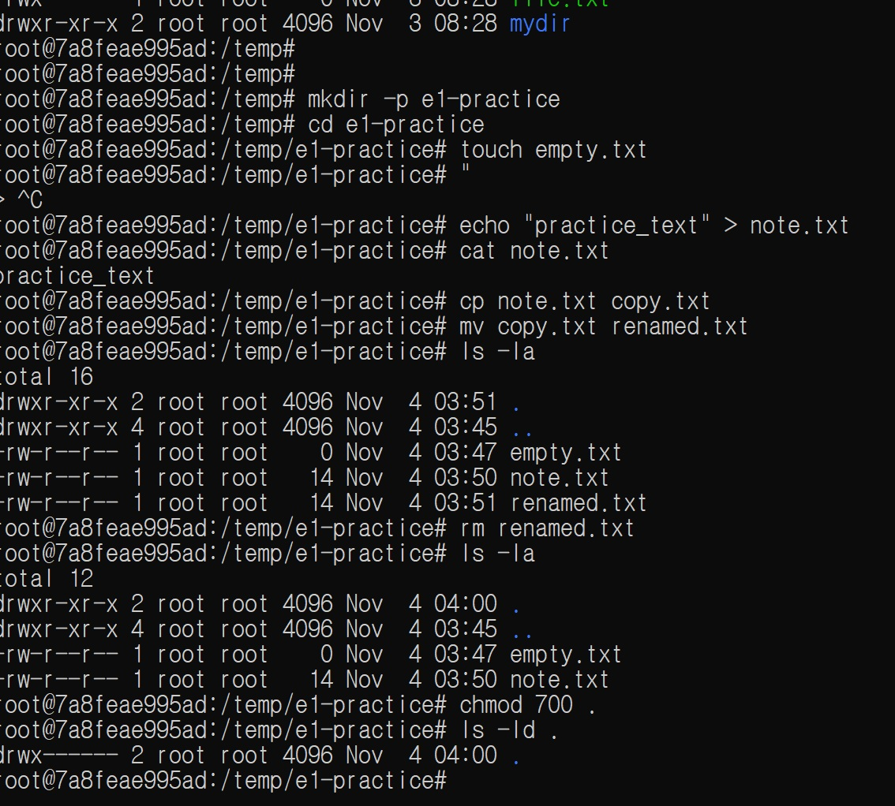

## Docker 점검 및 기본 운영

`docker --version`과 `docker info` 확인 결과의 핵심 항목을 요약했습니다. 상세 정보에서 고유 ID, 프록시 및 내부 레지스트리 주소는 제외했습니다. [docker_info.txt](docker_info.txt)

```text
> docker --version
Docker version 29.9.2, build a82e528

> docker info
Client: 29.9.2
Server: 29.9.2
Containers: 5 (Running: 3, Stopped: 2)
Images: 4
Environment: Docker Desktop, Linux containers on WSL2
```

**`hello-world` 실행** ([docker_run.jpg](captures/docker_run.jpg))

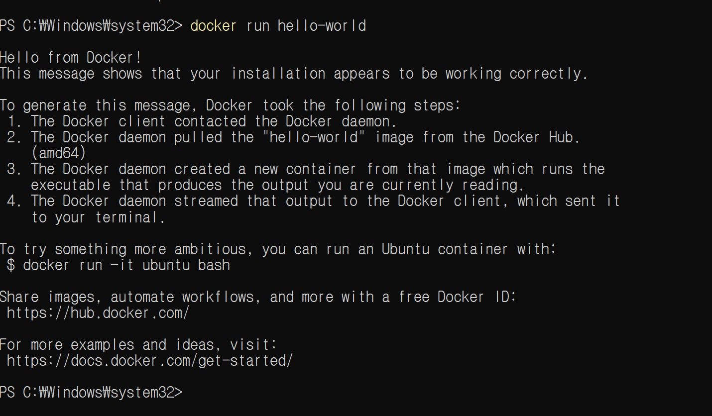

```powershell
docker images
docker ps
docker ps -a
docker logs e1-web
docker stats --no-stream
docker run --rm hello-world
```

컨테이너 목록(`docker ps`) 증거는 아래 [Ubuntu 컨테이너](#ubuntu-컨테이너)의 [exit_exec.jpg](captures/exit_exec.jpg)에 있습니다.

**`docker images`** ([logs/docker_images.txt](logs/docker_images.txt))

```text
$ docker images
IMAGE                ID             DISK USAGE   CONTENT SIZE   EXTRA
e1-web:1.0           50c6bd56a4d2       93.6MB         26.3MB   U
hello-world:latest   c567b231f656       25.9kB         9.49kB   U
nginx:alpine         785835ea65db       94.5MB         27.2MB   U
ubuntu:latest        6a06111c3b0a        163MB         45.9MB   U
```

**`docker stats --no-stream`** ([logs/docker_stats.txt](logs/docker_stats.txt))

```text
$ docker stats --no-stream
CONTAINER ID   NAME      CPU %     MEM USAGE / LIMIT     MEM %     NET I/O           BLOCK I/O         PIDS
fd2a9e7561ba   e1-bind   0.00%     16.23MiB / 15.28GiB   0.10%     8.91kB / 6.71kB   5.66MB / 12.3kB   17
73fa36642188   e1-web    0.00%     15.29MiB / 15.28GiB   0.10%     15.6kB / 7.14kB   315kB / 12.3kB    17
7a8feae995ad   mybox     0.00%     12.04MiB / 15.28GiB   0.08%     1.58kB / 126B     18MB / 12.3kB     2
```

**`docker logs e1-web`** — 출력이 41줄이라 링크로 남깁니다: [logs/docker_logs_e1-web.txt](logs/docker_logs_e1-web.txt)
- 요약: nginx 1.31.8 시작, `GET /` 200 응답(curl, Chrome), `favicon.ico` 404

### Ubuntu 컨테이너

```powershell
docker run -it --name mybox ubuntu bash
# 컨테이너 안에서
pwd
ls -la
echo "hello from ubuntu"
exit
```

`docker run -it`는 컨테이너를 새로 만들고 대화형으로 진입하며, `docker exec -it`는 실행 중인 컨테이너에 추가 프로세스로 진입합니다. 종료 후 상태와 재진입을 관찰한 결과는 다음과 같습니다.

```powershell
docker ps -a
docker start mybox
docker exec -it mybox bash
```

관찰: `docker ps -a`에서 `mybox`가 종료된 상태인 것을 확인하고 `docker start mybox`로 재시작했습니다. `docker exec -it mybox bash`로 진입해 명령을 실행한 뒤 `exit`해도 원래 컨테이너는 실행 중이어서 `docker ps`에 표시됐습니다.

**종료된 컨테이너 재시작, `docker exec` 재진입, `docker ps` 확인** ([exit_exec.jpg](captures/exit_exec.jpg))

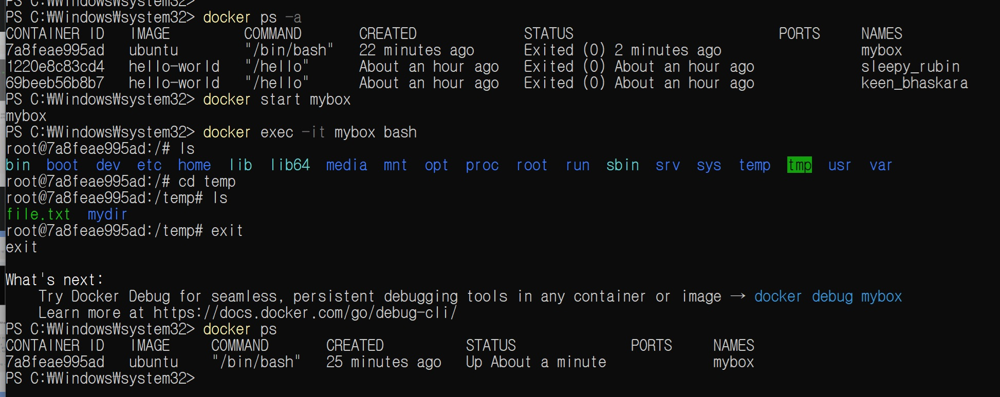

**컨테이너 OS 확인 (`/etc/os-release`, Ubuntu 26.04.1 LTS)** ([linux_os_release.jpg](captures/linux_os_release.jpg))

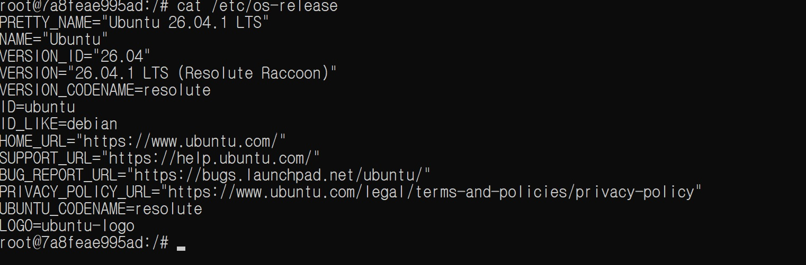

## Dockerfile 웹 서버

- 베이스 이미지: `nginx:alpine` (경량 NGINX 웹 서버)
- 커스텀 내용: 직접 만든 정적 HTML을 이미지의 기본 웹 루트로 복사
- 웹 소스: [`site/index.html`](site/index.html)

```text
E1-1/
├── README.md
├── Dockerfile
└── site/index.html
```

실제 [Dockerfile](Dockerfile)과 웹 소스는 저장소에 포함되어 있습니다.

```dockerfile
FROM nginx:alpine
COPY site/ /usr/share/nginx/html/
```

```powershell
docker build -t e1-web:1.0 .
docker run -d --name e1-web -p 8080:80 e1-web:1.0
docker ps
curl.exe http://localhost:8080
docker logs e1-web
```

- 접속 주소: `http://localhost:8080`
- 브라우저 접속 증거: [localhost.jpg](captures/localhost.jpg)

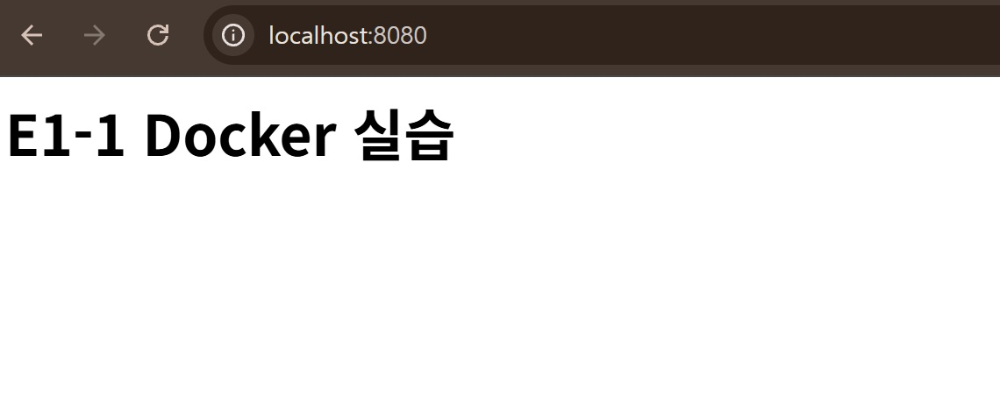

- 참고: `e1-web:1.0` 이미지는 `index.html` 문구가 `E1-1 Docker 실습`일 때 빌드했습니다. 이후 같은 파일을 바인드 마운트 실습에서 `호스트 변경 반영 확인`으로 고쳤기 때문에, 지금 저장소로 다시 빌드하면 새 문구가 나옵니다. `COPY`로 넣은 파일은 빌드 시점에 고정된다는 것을 보여 주는 예입니다.

## 바인드 마운트 반영

호스트의 `site/` 폴더를 컨테이너 웹 루트에 읽기 전용(`:ro`)으로 연결하고, 컨테이너를 재시작하지 않은 채 호스트 파일만 수정해 응답을 비교했습니다.

```powershell
docker run -d --name e1-bind -p 8081:80 -v "${PWD}\site:/usr/share/nginx/html:ro" nginx:alpine
curl.exe http://localhost:8081
# site/index.html을 수정한 뒤 다시 요청
curl.exe http://localhost:8081
```

- 변경 결과: 호스트 파일의 문구 `호스트 변경 반영 확인`이 컨테이너 웹 응답으로 표시됨
- 브라우저 증거: [host_change.jpg](captures/host_change.jpg)

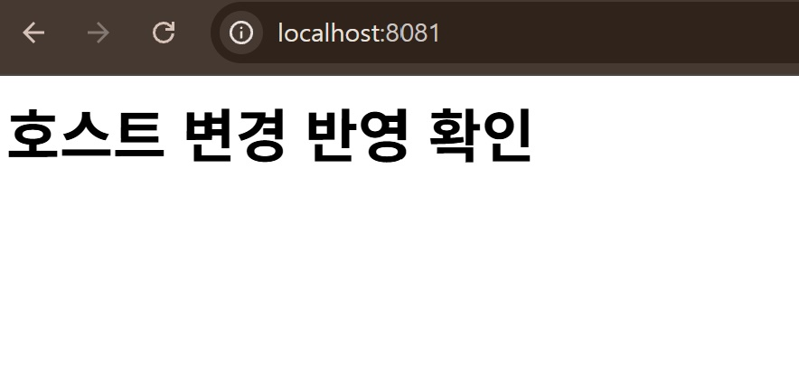

- 터미널 응답 비교 (`localhost:8081`, 전체 출력: [logs/bind_mount.txt](logs/bind_mount.txt))

| 단계 | 응답의 `<h1>` |
|---|---|
| 수정 전 | `호스트 변경 반영 확인` |
| 호스트에서 문구 수정 직후 | `바인드 마운트 실시간 반영 테스트` |
| 원래 내용으로 복구 후 | `호스트 변경 반영 확인` |

결론: 바인드 마운트는 호스트 파일을 그대로 보여 주므로, 이미지를 다시 빌드하거나 컨테이너를 재시작하지 않아도 수정 내용이 바로 응답에 반영됩니다. 반면 `e1-web`처럼 `COPY`로 넣은 파일은 이미지를 다시 빌드해야 바뀝니다.

## Docker 볼륨 영속성

```powershell
docker volume create e1-data
docker run -d --name e1-vol -v e1-data:/data ubuntu sleep infinity
docker exec e1-vol bash -lc "echo persistent-data > /data/check.txt && cat /data/check.txt"
docker rm -f e1-vol
docker run -d --name e1-vol-check -v e1-data:/data ubuntu sleep infinity
docker exec e1-vol-check cat /data/check.txt
docker volume inspect e1-data
docker rm -f e1-vol-check
```

- 삭제 전 데이터: `e1-vol` 컨테이너에서 `/data/check.txt`에 `persistent-data`를 쓰고 확인
- 컨테이너 삭제: `docker rm -f e1-vol` 뒤 `docker ps -a --filter name=e1-vol` 결과가 비어 있음
- 삭제 후 새 컨테이너에서 읽은 값: `e1-vol-check`에서 `cat /data/check.txt` → `persistent-data` (데이터 유지 확인)
- 볼륨 검사 결과: Driver `local`, Mountpoint `/var/lib/docker/volumes/e1-data/_data`, Scope `local`
- 전체 출력: [logs/docker_volume.txt](logs/docker_volume.txt)

결론: 컨테이너를 삭제해도 Docker 볼륨에 저장된 데이터는 남아 있으며, 같은 볼륨을 연결한 새 컨테이너에서 다시 읽을 수 있습니다.

## Git 및 GitHub

```powershell
git config --global user.name "<표시 이름>"
git config --global user.email "<GitHub 등록 이메일>"
git config --global init.defaultBranch main
git config --list
git init
git add README.md
git commit -m "docs: add E1-1 mission README"
git branch -M main
git remote add origin https://github.com/smz7093-web/E1-1.git
git push -u origin main
```

- 저장소: [smz7093-web/E1-1](https://github.com/smz7093-web/E1-1) (README 푸시 완료)
- `git config --list` 결과: [git_config_list.jpg](captures/git_config_list.jpg)
  - `user.name`, `user.email`(캡처에서 마스킹), `init.defaultbranch=main`, `credential.helper=manager` 설정 확인
  - `init.defaultbranch`가 두 번 나오는 것은 Git for Windows 시스템 설정(`master`) 뒤에 사용자 전역 설정(`main`)이 이어서 읽히기 때문이며, 나중에 읽힌 `main`이 적용됨

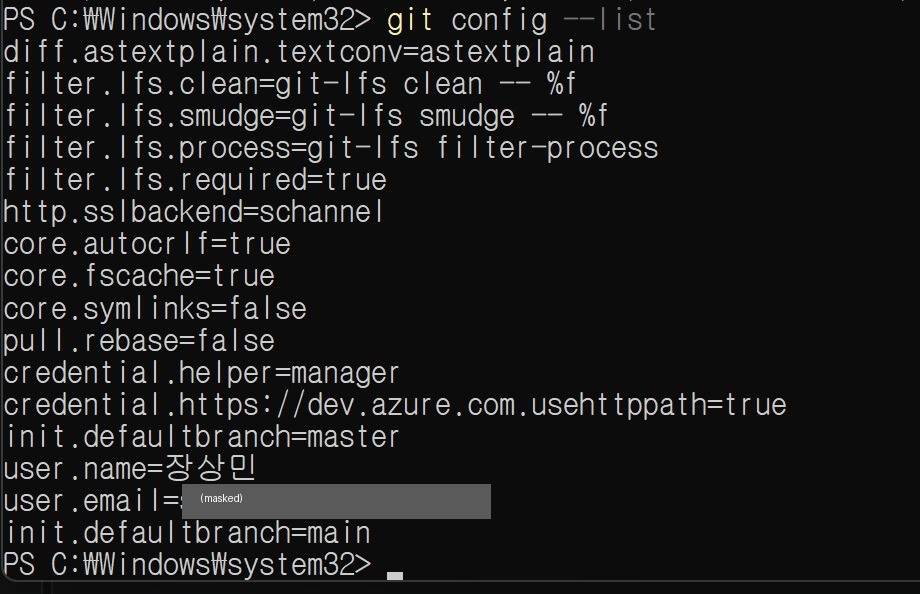

- VS Code GitHub 로그인/저장소 연동: [vscode_github.jpg](captures/vscode_github.jpg)
  - 계정 메뉴에 `smz7093-web (GitHub)` 로그인 상태 표시, 상태 표시줄에 `main` 브랜치와 동기화 아이콘이 보여 저장소가 연결되어 있음을 확인

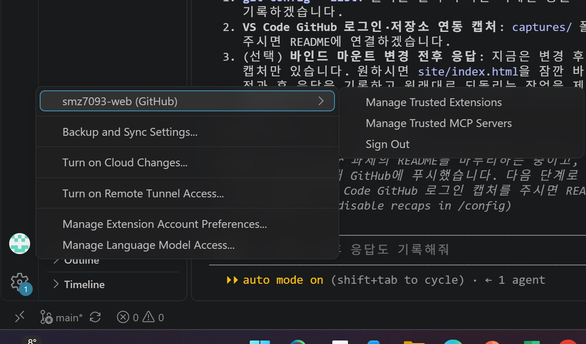

- 민감정보 점검: 캡처 속 이메일은 가렸고, 토큰·비밀번호는 문서에 넣지 않음. 개인 메모 파일은 `.gitignore`로 제외

## 보너스 과제

| 과제 | 결과 | 증거 |
|---|---|---|
| Docker Compose 기초 (단일 서비스) | 완료 | [compose/single/compose.yaml](compose/single/compose.yaml), [logs/compose_single.txt](logs/compose_single.txt) |
| Docker Compose 멀티 컨테이너 + 컨테이너 간 통신 | 완료 | [compose/multi/compose.yaml](compose/multi/compose.yaml), [logs/compose_multi.txt](logs/compose_multi.txt) |
| Compose 운영 명령어 (`up`, `down`, `ps`, `logs`) | 완료 | 위 두 로그 |
| 환경 변수로 포트/모드 변경 | 완료 | [compose/multi/.env](compose/multi/.env), [nginx 템플릿](compose/multi/nginx/default.conf.template) |
| GitHub SSH 키 설정 | 인증 확인 완료 | 아래 [GitHub SSH 키](#github-ssh-키) |

```text
compose/
├── single/compose.yaml                 # Dockerfile 이미지를 Compose로 실행
└── multi/
    ├── compose.yaml                    # web + checker, 전용 네트워크 e1-net
    ├── .env                            # HOST_PORT, NGINX_PORT, APP_MODE 기본값
    └── nginx/default.conf.template     # 환경 변수가 들어가는 nginx 설정
```

### Compose 기초: 단일 서비스

```yaml
name: e1-single
services:
  web:
    build:
      context: ../..          # 저장소 루트의 Dockerfile 사용
    image: e1-web:compose
    container_name: e1-compose-web
    ports:
      - "8082:80"
    restart: unless-stopped
```

```powershell
cd compose/single
docker compose up -d --build
docker compose ps
curl.exe http://localhost:8082
docker compose logs web
docker compose down
```

- 결과: `e1-compose-web`이 `0.0.0.0:8082->80/tcp`로 실행되고 `curl` 응답으로 `site/index.html`이 돌아옴. `down` 이후 `ps` 목록이 비어 있음
- 배운 점: `docker build` + `docker run -d --name ... -p ...`에 넣던 옵션이 파일에 남습니다. 그래서 누가 실행해도 같은 설정이 재현되고, 설정 변경이 Git 이력에 기록됩니다. 명령어가 "문서화된 실행 설정"으로 바뀌는 셈입니다.

### Compose 멀티 컨테이너와 네트워크

- `web`: nginx 웹 서버. `site/`를 읽기 전용으로 마운트하고, `/mode` 경로에서 현재 모드와 포트를 응답
- `checker`(보조 서비스): 10초마다 `http://web:<포트>/mode`를 요청해 결과를 로그로 남김
- 두 서비스는 Compose가 만든 사용자 정의 네트워크 `e1-net`에 함께 연결됨

```powershell
cd compose/multi
docker compose up -d
docker compose ps
docker compose exec checker nslookup web
docker compose exec checker wget -qO- http://web:8080/mode
docker compose logs checker
```

```text
$ docker compose exec checker nslookup web
Name:	web
Address: 172.18.0.2
$ docker compose exec checker wget -qO- http://web:8080/mode
mode=development port=8080

$ docker compose logs checker
checker-1  | [checker] 11:54:32 mode=development port=8080
checker-1  | [checker] 11:54:42 mode=development port=8080
```

- 결과: `checker`가 IP가 아닌 **서비스 이름 `web`**으로 접속에 성공. `web` 로그에는 `172.18.0.3`(checker)의 `Wget` 요청과 호스트(`172.18.0.1`)의 `curl` 요청이 함께 기록됨
- 배운 점: Compose 네트워크에는 내장 DNS가 있어 서비스 이름이 컨테이너 IP로 바뀝니다(서비스 디스커버리). 컨테이너를 다시 만들어 IP가 달라져도 이름은 그대로 쓸 수 있습니다. 컨테이너끼리는 호스트 포트(8083)가 아니라 컨테이너 포트(8080)로 통신합니다.

### Compose 운영 명령어: 상태 확인 루틴

| 단계 | 명령 | 확인 내용 |
|---|---|---|
| 실행 | `docker compose up -d` | 네트워크 → web → checker 순서로 생성(`depends_on`) |
| 상태 | `docker compose ps` | 서비스별 `STATUS`가 `Up`인지, 포트 매핑이 의도대로인지 |
| 로그 | `docker compose logs [--tail N] <서비스>` | 시작 오류, 요청 응답 코드(200/4xx) |
| 종료 | `docker compose down` | 컨테이너와 네트워크가 함께 삭제되고 `ps`가 비는지 |

평소 점검 순서는 `ps`(살아 있나) → `logs --tail`(오류가 있나) → `curl`(실제로 응답하나)로 정했습니다. 전체 출력: [logs/compose_multi.txt](logs/compose_multi.txt)

### 환경 변수로 포트/모드 변경

`.env`의 기본값이 `compose.yaml`의 `${변수:-기본값}`에 들어갑니다. nginx 이미지는 시작할 때 `/etc/nginx/templates/*.template`을 `envsubst`로 처리하기 때문에, 설정 파일 안의 `${NGINX_PORT}`, `${APP_MODE}`가 실제 값으로 바뀝니다.

```nginx
server {
    listen ${NGINX_PORT};
    add_header X-App-Mode ${APP_MODE} always;
    location = /mode {
        default_type text/plain;
        return 200 "mode=${APP_MODE} port=${NGINX_PORT}\n";
    }
}
```

```bash
# 코드와 파일 수정 없이 셸 환경 변수로 덮어쓰기 (셸 변수 > .env)
NGINX_PORT=9090 APP_MODE=production docker compose up -d
```

| 설정 | 컨테이너 포트 매핑 | `curl.exe -i http://localhost:8083/mode` | checker → web |
|---|---|---|---|
| `.env` 기본값 | `8083->8080/tcp` | `X-App-Mode: development`, `mode=development port=8080` | `http://web:8080` |
| 환경 변수로 변경 | `8083->9090/tcp` | `X-App-Mode: production`, `mode=production port=9090` | `http://web:9090` |

- 결과: 값을 바꾸고 `up -d`를 다시 실행하자 Compose가 변경을 감지해 두 컨테이너를 `Recreate`했고, 서버 포트와 모드가 함께 바뀜
- 배운 점: 이미지와 설정 파일(코드)은 그대로 두고 실행 환경마다 값만 바꿀 수 있습니다(설정과 코드의 분리). 단, 비밀번호나 토큰은 `.env`에 넣으면 Git에 올라가므로 커밋하지 않는 별도 파일이나 시크릿으로 관리해야 합니다. 이 저장소의 `.env`에는 공개해도 되는 포트와 모드 값만 있습니다.

### GitHub SSH 키

```bash
ssh-keygen -t ed25519 -C "<GitHub 등록 이메일>"    # ~/.ssh/id_ed25519(개인키), id_ed25519.pub(공개키)
# 공개키(.pub) 내용을 GitHub > Settings > SSH and GPG keys에 등록
ssh -T git@github.com
```

```text
$ ssh-keygen -lf ~/.ssh/id_ed25519.pub
256 SHA256:rkssZ2iJ338/1FoOG8yy4SPmmDE7xzpxQOvfzdx+N4s (ED25519)
$ ssh -T git@github.com
Hi smz7093-web! You've successfully authenticated, but GitHub does not provide shell access.
```

- 결과: 등록한 ED25519 키로 GitHub 계정 `smz7093-web` 인증 성공(셸 접근을 제공하지 않아 종료 코드 1이 나오는 것은 정상)
- HTTPS와 SSH 비교: HTTPS는 계정과 토큰(Windows에서는 `credential.helper=manager`가 저장)으로 인증합니다. SSH는 내 PC의 개인키와 GitHub에 등록한 공개키 쌍으로 인증하므로 비밀값이 네트워크로 전송되지 않습니다.
- 보안 습관: 개인키(`id_ed25519`)는 공유하거나 커밋하지 않고 공개키만 등록합니다. 위 지문(fingerprint)은 공개키 식별값이라 공개해도 안전합니다. PC를 잃어버리면 GitHub에서 해당 키를 바로 삭제합니다.

## 트러블슈팅

### 사례 1

- 문제: `cdmod` 실행 시 `command not found` 오류
- 원인 가설: 권한 변경 명령 `chmod`의 철자를 잘못 입력함
- 확인: 오류 메시지를 확인하고 올바른 명령 `chmod 700 file.txt`를 실행한 뒤 `ls -l`로 권한 변경을 확인함
- 해결/대안: `chmod`로 다시 실행. 증거: [chmod.jpg](captures/chmod.jpg)

### 사례 2

- 문제: 따옴표만 입력해 Bash가 다음 입력을 기다리는 `>` 프롬프트로 바뀜
- 원인 가설: 닫는 따옴표가 없어 명령이 끝나지 않음
- 확인: `Ctrl+C`로 입력을 취소한 뒤 정상 명령을 실행함
- 해결/대안: `echo "practice_text" > note.txt`로 다시 입력하고 `cat note.txt`에서 내용을 확인함. 증거: [cp_rm_mv.jpg](captures/cp_rm_mv.jpg)

### 사례 3

- 문제: `docker logs e1-web`에 `"\x16\x03\x01..." 400` 같은 알아볼 수 없는 요청이 여러 줄 기록됨
- 원인 가설: `\x16\x03\x01`은 TLS(HTTPS) 핸드셰이크의 시작 바이트입니다. 브라우저가 `https://localhost:8080`으로 접속을 시도했는데, 컨테이너의 nginx는 80번 포트에서 HTTP만 받기 때문에 요청을 해석하지 못함
- 확인: 같은 시각(07:16:51) 이후 `GET / HTTP/1.1` 200 응답이 Chrome에서 정상 기록됨(07:17:08)
- 해결/대안: 주소를 `http://localhost:8080`으로 명시해 접속. 증거: [logs/docker_logs_e1-web.txt](logs/docker_logs_e1-web.txt)

## 핵심 개념

- **절대/상대 경로:** 절대 경로는 전체 위치(`C:\Users\ADMIN\E1-1\README.md`), 상대 경로는 현재 위치 기준(`.\README.md`)입니다.
- **권한:** Linux의 `r/w/x`는 읽기/쓰기/실행입니다. `755`는 소유자 `rwx`, 나머지 `r-x`; `644`는 소유자 `rw-`, 나머지 `r--`입니다. Windows ACL은 별도 모델입니다.
- **이미지/컨테이너:** 이미지는 실행에 필요한 파일과 설정의 묶음이고 컨테이너는 이미지에서 실행되는 격리 인스턴스입니다.
- **포트 매핑:** `-p 호스트포트:컨테이너포트`로 호스트 요청을 컨테이너 서비스로 전달합니다.
- **바인드 마운트/볼륨:** 바인드 마운트는 호스트 경로를 연결합니다. 볼륨은 Docker가 관리하며 컨테이너와 데이터의 생명주기를 분리합니다.
- **Git/GitHub:** Git은 로컬 변경 이력 관리 도구이고 GitHub는 원격 저장소 및 협업 플랫폼입니다.

## 제출 전 확인

- [x] 실제 수행 명령과 출력으로 문서 갱신
- [x] Dockerfile 및 웹 소스 포함
- [x] 포트 접속, 마운트 반영, 볼륨 영속성 증거 링크
- [x] 트러블슈팅 2건 이상 (3건)
- [x] 캡처에 명령과 출력 포함, 민감정보 제거/마스킹 (캡처 11장 점검, `git config` 이메일 마스킹)
- [x] README에서 증거 파일 접근 가능 (캡처 11장 본문 표시, 로컬 링크 25개 확인)
- [x] GitHub 저장소 링크와 제출 권한 확인 (공개 저장소)
